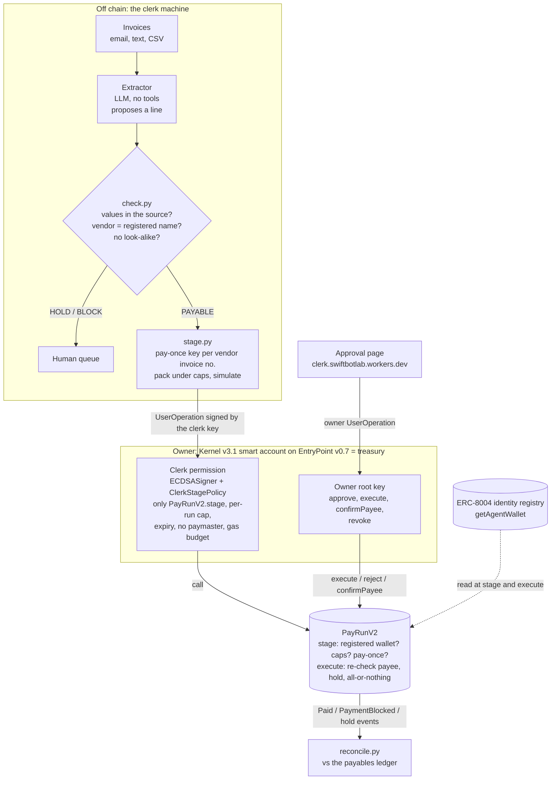

# Clerk architecture (one page)

Clerk pays supplier invoices in tUSD8 on Aevum. An AI reads the invoices; the contracts decide who can be paid. The
**canonical path** is **PayRunV2** (on-chain Confirmation of Payee with the payee-change hold) driven by a Kernel v3.1 smart
account, with the clerk's key living *inside* that account as a scoped **Kernel permission**. The older pieces (PayRun v1, the
`grantSession` key) still work and stay on testnet as the first runs, but new deployments use this path.

## Who can do what
| Actor | Can | Cannot |
|---|---|---|
| Extractor (LLM) | propose a payment line | anything else: no tools, no keys; check.py ignores every value not found in the invoice |
| Clerk key (Kernel permission) | make the account call `PayRunV2.stage(lines)` within the per-run cap until it expires, paying gas from a capped budget | pay (`execute`), transfer tokens, batch, delegatecall, call any other contract, use a paymaster, confirm a payee, outlive its expiry or a revoke |
| PayRunV2 | pay a staged run's lines to the registered wallets, once per invoice, all or nothing | pay a wallet the vendor did not register, a held new/changed wallet, a run whose payee changed after staging, a stale (7-day) run |
| Owner (root key of the account) | approve, execute, reject, confirm a changed payee, revoke the clerk | be bypassed: no other key can sign the account's UserOperations (EntryPoint refuses: AA24) |

## One invoice, end to end
1. **Extract.** The model returns `{vendor, wallet, amount, currency, reference, due_date}`. It is a proposal only.
2. **Check (fail closed).** The amount, reference and due date must appear in the invoice. The vendor must be one of the known ERC-8004
   identities (loaded by agentId, never by name search), and the wallet must be that identity's registered wallet. A near-copy of the vendor's
   name anywhere in the document holds the line for a human. Result: PAYABLE, HOLD or BLOCK.
3. **Stage.** PAYABLE lines get a pay-once key (vendor agentId + normalised invoice number). Lines already paid or staged are skipped, and so are
   duplicates inside the batch. The rest are packed under the caps, simulated, then sent as one UserOperation under the clerk permission.
   PayRunV2 checks again on chain: registered wallet, caps, pay-once.
4. **Approve.** The owner opens the approval page. Each line shows its payee verdict and the invoice line behind every number. The owner
   pays with one UserOperation from the account. `execute` re-reads the registry. A new or changed wallet is held (`PaymentBlocked`,
   nothing moves) until the owner confirms that exact wallet or the hold window passes. A run whose payee changed after staging is closed.
5. **Reconcile.** `Paid` events are matched to the ledger. Unpaid, unexpected, short and duplicated payments are flagged, and so is every
   hold event.

## Where each guarantee lives
| Guarantee | Enforced by | Test / proof |
|---|---|---|
| Money only reaches a vendor's registered wallet | `PayRunV2.stage` + `execute` (registry read twice) | unit + fuzz tests; fork test on the real registry; eval: 0 wrong-payee payments |
| A changed vendor wallet can't be paid without the owner | PayRunV2 hold (`confirmPayee` is owner-only) | 19 hold tests incl. fuzzed A to B to A; testnet `PaymentBlocked` tx |
| The AI's key can't pay or drain | ClerkStagePolicy at UserOperation validation | 21 unit + 7 fork tests; 14 mutants; testnet refusals |
| Each vendor invoice is paid at most once | pay-once key in `stage.py` + PayRunV2's `paidInRun` / `stagedInRun` | eval: re-sent copies (same file, reminder copy, re-typed number) never paid twice |
| Model-invented or edited values aren't paid | `check.py` | 12 check tests; eval with a hostile extractor |
| Spending is bounded | per-run cap (policy + PayRunV2), per-day cap (PayRunV2), expiry, revoke | unit tests; eval: 0 over-cap payments |

## Deployed (Aevum testnet, chain 44005)
PayRunV2 `0x89d14Bf88D8dF1AB8b0F520414fbbC9e1d69F541` · ClerkStagePolicy `0x4Ea16B1bb18005344FC77491F3809a47C74c01a4` ·
owner/treasury Kernel account `0xc0bC2ab048dCa250417bEaFf6B68A222a4ae2d1C` · ERC-8004 registry `0xF45E7f39Caba1d2055f613970575a7e7069636Be` ·
tUSD8 `0x456569838f1d43009A91ebA4263147Afd7233483` · first PayRun (v1) `0x2EE29a167CDDb964aAB9C899ea9Ae89847e3Da98`.
Transaction links for every step are in the README's "Aevum testnet" table. The deployed bytecode is identical to this source
(`contracts/script/match_onchain.py`, metadata hash included).
