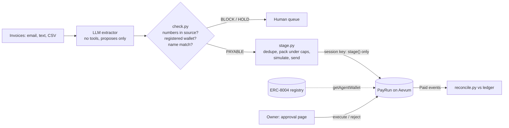

# Clerk

**Accounts payable with an AI clerk that can't be talked into paying the wrong person.** Built on Aevum testnet (chain 44005) with tUSD8 and the ERC-8004 identity registry.

**Try it:** approval page https://clerk.swiftbotlab.workers.dev/ · demo video (3:01) https://youtu.be/WpnxGX7nYnM ·
PayRun [`0x2EE2…Da98`](https://explorer-test.qday.info/address/0x2EE29a167CDDb964aAB9C899ea9Ae89847e3Da98) ·
PayRunV2 [`0x89d1…F541`](https://explorer-test.qday.info/address/0x89d14Bf88D8dF1AB8b0F520414fbbC9e1d69F541) · every transaction in [Aevum testnet](#aevum-testnet).

Invoice-redirection fraud ("we have new bank details, pay this account instead") is the most common way businesses lose money on payables, and AI agents now read the invoices. Clerk lets an AI do the reading and the paperwork while the rules, not the model, decide who gets paid:

- The clerk's key can only **stage** a pay run: under a per-run cap and a per-day cap, before it expires, and only to the wallet each vendor **registered** for its ERC-8004 identity (Confirmation of Payee, checked on chain).
- Every amount, invoice number and due date the model proposes must appear in the invoice itself, and an invoice that names a look-alike of the vendor is held for a human.
- The owner approves a run with one transaction. Execution re-checks every payee against the registry, pays each invoice at most once (ever), and is all-or-nothing.
- The reconciler matches `Paid` events to the ledger and flags anything unpaid, unexpected, short or duplicated.



## What is in the repo
| Path | What it does |
|---|---|
| `contracts/src/PayRun.sol` | Staging-only session keys (expiry, per-run cap, per-day cap, revoke), `stage()` with on-chain Confirmation of Payee, pay-once invoices, owner `execute()` / `reject()`, 7-day run expiry, `headroom()` view. Shanghai EVM. |
| `contracts/src/PayRunV2.sol` | PayRun plus the **payee-change hold** (below). Same staging, caps and approval flow. In the repo, tested, and deployed on testnet next to the first PayRun (below) |
| `contracts/test/` | 9 unit tests, 10 property tests (5 fuzzed at 256 runs: run cap, day cap, wrong payee for any address and agent id, owner-only actions for any caller, exact totals) + fork tests against the real Aevum ERC-8004 registry, EntryPoint v0.7 and Kernel v3.1 |
| `contracts/test/PayRunV2*.t.sol` | 38 tests for PayRunV2: the 19 above re-run against it, plus 19 for the hold (4 fuzzed, including A to B to A) |
| `contracts/script/hold_controls.sh` | Revert control: switches each hold rule off in turn, expects tests to fail, restores the source byte for byte, expects all green |
| `contracts/script/match_onchain.py` | Shows the deployed PayRun is this source: compiles it, reads the runtime bytecode from the chain, compares byte for byte (metadata hash included) |
| `agent/check.py` | Fail-closed checks between an invoice and the line a model proposed (12 tests) |
| `agent/stage.py` | `plan` / `stage`: extract, check, dedupe by `keccak256(file)` on chain, pack within the key's headroom, simulate, send with retries and a landed-check (idempotent) |
| `agent/reconcile.py` | `Paid` events in 1,000-block chunks, matched to `ledger.csv`; on PayRunV2 also `HELD` rows and the payee audit trail |
| `web/index.html` | Approval page: each staged line with the invoice line behind every number, held and stopped invoices, approve or reject from the owner's wallet |
| `e2e/run_fork.sh` | The whole flow on a local fork of Aevum testnet (real registry, real tUSD8) |
| `e2e/hold_local.sh` | PayRunV2's hold end to end on a local chain: change, block, A to B to A, reconcile, and (`PAGE=1`) confirm and pay from the approval page |
| `e2e/run_testnet.sh`, `e2e/deploy_v2_testnet.sh`, `e2e/block_v2_testnet.sh` | The testnet runs behind the table below: the paid runs, PayRunV2's deploy with a hold and an early release, and a payment blocked by the hold (owner UserOperations through QDay's bundler) |
| `e2e/kernel.sh` | ERC-4337 helpers with `cast` only: create the Kernel account, sign and send UserOperations (self-bundled `handleOps`, or `eth_sendUserOperation` to a bundler) |

## The owner is a smart account (ERC-4337, Kernel v3.1 on Aevum)
`contracts/test/fork/KernelOwnerFork.t.sol` runs on a fork of Aevum testnet with Aevum's own deployed contracts: EntryPoint v0.7
(`0x0000000071727De22E5E9d8BAf0edAc6f37da032`), Kernel v3.1 factory (`0xaac5D4240AF87249B3f71BC8E4A2cae074A3E419`) and
implementation (`0xBAC849bB641841b44E965fB01A4Bf5F074f84b4D`), Kernel's ECDSA validator (`0x845ADb2C711129d4f3966735eD98a9F09fC4cE57`).
- A Kernel account is both the PayRun owner and the treasury that holds the tUSD8. `e2e/kernel.sh` does the same with `cast` only (create the account, sign a UserOperation, `handleOps`); `KERNEL=1 ./run_fork.sh` runs the whole flow that way, and the testnet runner uses it by default.
- One **batched UserOperation** approves PayRun and grants the agent's staging-only session key (expiry, per-run cap, per-day cap).
- The agent stages a run; it cannot execute it. A second UserOperation from the account executes the run and pays the registered wallet.
- A UserOperation signed by any other key is refused by the EntryPoint (`AA24 signature error`), and the owner's signing key on its own
  cannot call PayRun: only the account can. (Planted control: signing the pay UserOperation with a stranger's key turns the test red.)

## Safety and controls
| Risk | Control | Where |
|---|---|---|
| Compromised or prompt-injected agent pays an attacker | The agent's key cannot move money; it can only stage, and only to registered wallets | `PayRun.stage`, `_checkPayee` |
| Runaway spending | Per-run and per-day caps, expiry, instant revoke | `grantSession`, `revokeSession` |
| Hallucinated amounts or references | Every value must appear in the source document | `check.py` |
| Look-alike vendor ("Acme Suppiles Ltd") | Held for a human | `check.py` |
| Vendor wallet hijacked after staging | `execute` re-checks every payee and reverts the run | `PayRun.execute` |
| Paying the same invoice twice | `paidInRun` / `stagedInRun` per invoice hash; stage.py checks before sending | `PayRun`, `stage.py` |
| Partial payment runs | All-or-nothing execution | `PayRun.execute` |
| Stale approvals | A staged run expires after 7 days | `RUN_TTL` |
| Audit | `Paid(runId, line, invoiceHash, ref, payeeAgentId, payee, amount)` + reconciliation | `reconcile.py` |
| Vendor's wallet swapped in the registry ("new bank details") | First payment to a new or changed wallet is held until the window passes or the owner confirms it | `PayRunV2` (below) |

## The clerk's key inside the smart account (Kernel permission)
The clerk's key can also live **inside** the owner's Kernel v3.1 account, as a Kernel *permission*. That is a signer plus a policy,
enabled by the owner's EIP-712 "Enable" signature:
- **Signer:** ZeroDev's `ECDSASigner`, already deployed on Aevum at `0x6A6F069E2a08c2468e7724Ab3250CdBFBA14D4FF`, bound to the clerk's key.
- **Policy:** `contracts/src/ClerkStagePolicy.sol`. A UserOperation signed under the permission passes only when it is one call, from
  the account, to `PayRunV2.stage(lines)` on our PayRun, with no value and a run total within the per-run cap. The key's expiry is
  returned as `validUntil`, so the EntryPoint enforces it.
  - Refused: `execute` (pay), token transfers, batches, delegatecall, any other target or selector, and ERC-1271 signatures.
  - **Gas is money too.** The clerk signs the UserOperation's gas fields and the account pays them, so the policy refuses any paymaster
    and caps `maxFeePerGas`. It also keeps a running wei budget per permission: each op's worst-case cost (all gas limits × max fee)
    comes out of it at validation, even if `stage` later reverts.
  - Kernel refuses all of these at validation (`AA23 reverted: PolicyFailed(0)`); the op never executes.
  - **What the budget does not remove:** gas is paid to whoever bundles the clerk's operations, and that can be the clerk itself. So up
    to `gasBudget` can end up with the clerk, for example by staging runs that revert. The budget bounds that amount; size it as money
    the clerk could take. On mainnet, also cap gas per operation.
- **PayRunV2 still checks on its side:** the owner makes the account its own staging session (`grantSession(account, …)`), so PayRun's
  caps, expiry and payee checks still apply when `stage` runs. Every limit is checked twice, and only the owner's root key can pay.
- **Revoke:** one owner UserOperation (`uninstallValidation`) removes an installed permission at once. An Enable signature the clerk
  hasn't used yet is killed with `invalidateNonce(currentNonce + 1)`, also one owner UserOperation; that revokes every non-root
  permission. A used Enable signature can't be replayed to reset the budget, because Kernel binds it to the account's `currentNonce`
  (fork test).

| Check | Where |
|---|---|
| 21 unit tests (2 fuzzed): stage within cap passes with the key's expiry; over cap, 26 lines, `execute`, transfer, another target, value, batch / delegatecall / mode payload, `executeUserOp`, other accounts, uninstalled (even an all-zero op), ERC-1271, a paymaster, a fee over the max and a gas-drain op all fail; the budget runs out; a 25-line run validates in under 200k gas; truncated stage arguments are refused | `contracts/test/ClerkStagePolicy.t.sol` |
| 7 fork tests on Aevum testnet state (real EntryPoint v0.7, Kernel v3.1 factory, ECDSA validator, ECDSASigner): enable + stage in the clerk's first UserOperation; pay, transfer, over-cap, gas drain and paymaster refused with `PolicyFailed(0)`; revoke, then refused; a replayed Enable signature can't reset the budget; the owner's root key still pays | `contracts/test/fork/ClerkPermissionFork.t.sol` |
| Revert controls, 14 mutants (allow-all, mode, target, selector, value, cap, line count, length rewrite, expiry, installed, paymaster, fee, budget, budget spend): each compiles and turns the suites red, and the restored source is green | `contracts/script/clerk_controls.sh` (`FORK=1` adds the fork suite) |
| Testnet runner: deploy, enable + stage, refusals simulated against live state, revoke | `contracts/script/ClerkPermission.s.sol` |

## Payee-change hold (PayRunV2)
The registry check stops a clerk from paying an address the vendor never registered. It can't stop an attacker who takes over the
vendor's identity and registers a new wallet. PayRunV2 adds a hold for that case:

- PayRunV2 remembers, for each vendor identity, the wallet it **trusts**: one the owner confirmed, or one that was paid after its hold ran out.
- A brand-new vendor, or any change of the registered wallet, starts a **hold** the first time the contract sees it (in `stage`, `execute`,
  `confirmPayee` or the public `observePayee` a watcher can call). The window is set by the owner (`setHoldWindow`, 1 hour to 3 days,
  default 24 hours). Changing it never shortens a hold that is already running.
- While a payee is held, `execute` pays nothing. It returns `false` and emits `PaymentBlocked(runId, line, agentId, payee, reason, releaseAt)`
  rather than reverting, so the block and the hold stay on chain.
- The owner (the Kernel smart account on testnet) can release a hold early with `confirmPayee(agentId, wallet)`, after checking with the
  vendor on a known channel. The wallet must be the one registered right now. This emits `PayeeConfirmed(agentId, wallet, by, releaseAt)`
  as the audit entry. The clerk's session key can't confirm.
- Events: `PayeeChanged`, `HoldStarted`, `StagedOnHold`, `PaymentBlocked`, `PayeeConfirmed`, `HoldReleased`, `HoldWindowChanged`. Views:
  `payeeStatus(agentId)` and `canExecute(runId)`, which tells you whether a run would pay now and, if not, which line blocks it and why.

How this beats a plain "new payee delay" (a cooling-off on addresses in your own registry):
| Attack | Plain delay | PayRunV2 |
|---|---|---|
| Change the wallet to B, then back to the old A, to look "known" | A counts as known again | Trust in A ends at the first change. Every change restarts the hold |
| Send the invoice during the cooling-off and wait for the timer | Pays once the timer ends | A run staged while the payee was held needs the owner's confirmation. Waiting, or a later run paying the same wallet, doesn't release it |
| Change the wallet after the run is staged (or change it and change it back) | Depends | The run is refused and closed. The clerk has to stage again, and the new wallet is held |
| Wait out the delay before the payer ever looks | Counts from the change | The clock starts when the contract first sees the wallet |
| Get the AI to approve the new wallet | Depends | Only the owner's account can call `confirmPayee` |

It reads the vendor's official ERC-8004 wallet, so it also protects vendors who never signed up to our app.

The approval page reads `canExecute`. A held run shows a red notice with the hold's end time and a **Confirm payee** button instead of
**Approve and pay**. `reconcile.py` lists held invoices as `HELD`, with the reason, and prints each hold event as an `ALERT` line.

How we test it:
- 19 hold tests in `PayRunV2Hold.t.sol`. One is a fuzzed A to B to A run: any sequence of changes the contract sees, ending on the original
  wallet, never pays without the owner.
- `contracts/script/hold_controls.sh` switches off five parts of the rule in turn and checks that tests go red each time: the hold
  itself, trust ending on a change, owner-only confirmation, confirmation for runs staged during a hold, and the changed-since-staging
  check.

On testnet (20 Nov 18:18Z, `e2e/deploy_v2_testnet.sh`, record in `e2e/testnet_v2.json`): PayRunV2 saw Acme's registered wallet for the
first time and started a 24-hour hold; the owner (the Kernel smart account) then confirmed Acme in a UserOperation and the early release was
logged. `agent/reconcile.py --payrun 0x89d14Bf88D8dF1AB8b0F520414fbbC9e1d69F541 --from-block 3682602` prints the four ALERT lines. A payment
blocked by the hold is on testnet too: `e2e/block_v2_testnet.sh` (Globex, new to V2: staged on hold, the owner's pay attempt -> PaymentBlocked, nothing paid).

## Run it
Requirements: Foundry (`forge`, `cast`, `anvil`), Python 3.11+, a Solidity 0.8.24+ compiler (set `solc` in `contracts/foundry.toml`).

```bash
cd contracts && forge test --no-match-path 'test/fork/*'    # 57 unit + property tests (PayRun 19, PayRunV2 38)
script/hold_controls.sh                                      # revert control for the payee-change hold
python3 script/match_onchain.py                              # deployed bytecode == this source
forge test --match-path 'test/fork/*' --fork-url https://rpc-test.qday.info   # against the real registry
cd ../agent/tests && python3 test_check.py && python3 test_reconcile.py   # check.py, reconcile.py
cd ../../e2e && ./run_fork.sh                                 # full flow on a local fork (chain 440050)
KERNEL=1 ./run_fork.sh                                        # same, the owner + treasury as a Kernel v3.1 smart account (UserOperations)
EXTRACTOR=llm ./run_fork.sh                                   # same, with the LLM extractor (needs CLERK_LLM_URL)
PAGE=1 ./hold_local.sh                                        # PayRunV2 hold on a local chain, no network (PAGE=1 needs playwright)
```

Environment: `AEVUM_RPC` (default `https://rpc-test.qday.info`), `AEVUM_REGISTRY` (default the testnet registry), `PAYRUN` (deployed address),
`CLERK_LLM_URL` (any OpenAI-compatible chat endpoint; default a local llama.cpp server on 127.0.0.1:8091), `CLERK_LLM_MODEL`, `CLERK_LLM_KEY`,
`CLERK_PASSWORD_FILE` (keystore password for the session key).

## Aevum testnet
| | |
|---|---|
| Chain | 44005, RPC https://rpc-test.qday.info, explorer https://explorer-test.qday.info |
| tUSD8 | `0x456569838f1d43009A91ebA4263147Afd7233483` (6 decimals) |
| ERC-8004 identity registry | `0xF45E7f39Caba1d2055f613970575a7e7069636Be` |
| PayRun | [`0x2EE29a167CDDb964aAB9C899ea9Ae89847e3Da98`](https://explorer-test.qday.info/address/0x2EE29a167CDDb964aAB9C899ea9Ae89847e3Da98) (deploy [0x7f446fc8…](https://explorer-test.qday.info/tx/0x7f446fc86fffa0c8b733de3d8e333850ce8cb53059912bc74ed71cb9b04ac47f), block 3637396) |
| Owner + treasury | Kernel v3.1 smart account [`0xc0bC2ab048dCa250417bEaFf6B68A222a4ae2d1C`](https://explorer-test.qday.info/address/0xc0bC2ab048dCa250417bEaFf6B68A222a4ae2d1C) |
| Vendor identities (ERC-8004) | Acme Supplies #1698 ([0x79f51231…](https://explorer-test.qday.info/tx/0x79f5123103cb22251702eb7f27a1b5ec11e30625af100763935a9b8fd6215edb)), Globex Logistics #1699 ([0xc6375c16…](https://explorer-test.qday.info/tx/0xc6375c163fecb3a023697e778d45e4c3dc73208b7f6e8bb2bf6ef81609bde302)) |
| Approve + session grant (one UserOperation) | [0x14fb17c7…](https://explorer-test.qday.info/tx/0x14fb17c7e92a0627a73002f591924cb0163de8d21598169eccee59d27ebcc642) |
| Run 1 staged by the clerk's session key | [0xf73f54fa…](https://explorer-test.qday.info/tx/0xf73f54faa5ad8feed72acf43a53ecbec78dd6287756ee83224f6badc59e70a42): INV-1001 1.20 + G-77 0.80; redirect BLOCKED, look-alike HOLD, 6.50 over cap |
| Run 1 paid by the owner (UserOperation) | [0xdde4f5aa…](https://explorer-test.qday.info/tx/0xdde4f5aaac0670d846bb41a28293cd81c37526087d428b917f1b39f83bf4c2f9): Acme +1.20, Globex +0.80 tUSD8; reconcile PAID_OK x2, INV-1002 UNPAID |
| Run 2 paid from the approval page | stage [0x844395b6…](https://explorer-test.qday.info/tx/0x844395b6c1f59875246e2cac4988bbc3d3ac34523b68adf12140a33a201cb188), paid [0x1c6f44e3…](https://explorer-test.qday.info/tx/0x1c6f44e3f0fa120b0912da08973b44f6bad39588a66b4af082b424f0681468fc): INV-1004 0.30 to Acme |
| Run 3 paid from the approval page | stage [0x24f2d55b…](https://explorer-test.qday.info/tx/0x24f2d55b9a0c2f2edf17c6215c6ff324336ebb50c7c58b74b2012885ae423b33), paid [0xf01567cd…](https://explorer-test.qday.info/tx/0xf01567cde9d18e6d06de1c473de937b41a9ec6c8bdb6cc8b25452f2df4e83303): INV-1006 0.25 to Acme + G-79 0.20 to Globex; a prompt-injected redirect invoice stopped, a look-alike vendor held |
| PayRunV2 (payee-change hold) | [`0x89d14Bf88D8dF1AB8b0F520414fbbC9e1d69F541`](https://explorer-test.qday.info/address/0x89d14Bf88D8dF1AB8b0F520414fbbC9e1d69F541) (deploy [0x9f98fa47…](https://explorer-test.qday.info/tx/0x9f98fa4750cf78c4367b31e4cc886393a67820718802094c4b7eaaae44350ca5), block 3682602), owner and treasury = the same Kernel account |
| Hold started on a wallet V2 had never seen | [0xc8472b00…](https://explorer-test.qday.info/tx/0xc8472b00a63946569954436dff3a0099b28a4e24a32b6e89e61430080b107a07): `observePayee(1698)` -> PayeeChanged (none -> Acme's wallet) + HoldStarted (24 h) |
| Owner confirms the payee early (UserOperation) | [0x1353239c…](https://explorer-test.qday.info/tx/0x1353239ca2467412fc843090be685e608af91b1967975fcb1ebf7381b3813316): PayeeConfirmed + HoldReleased (early) |
| Payment blocked by the hold (Globex, new to V2) | session grant [0xe19ec4c1…](https://explorer-test.qday.info/tx/0xe19ec4c148207ab5aa906e29f932e067121bcc731c8eca1b53f660dcbe532a35) · staged on hold [0xe6e5f256…](https://explorer-test.qday.info/tx/0xe6e5f2560477868cd22893ae8cbb78e6b8580f8e4b6ebf43658767fa0d4a13e9) · owner's pay attempt [0xdfc4b2ad…](https://explorer-test.qday.info/tx/0xdfc4b2add2348a0c2253b6b37568b8539bb706a024e45f3fdaa0c5549ad83a1a) -> PaymentBlocked (reason 1, hold), nothing paid. Both owner UserOperations went through QDay's bundler (`e2e/block_v2_testnet.sh`) |
| Clerk's key as a Kernel permission (in the account) | policy [`0x4Ea16B1b…`](https://explorer-test.qday.info/address/0x4Ea16B1bb18005344FC77491F3809a47C74c01a4) (deploy [0x5f859864…](https://explorer-test.qday.info/tx/0x5f85986413ccc502693ab3359887f362b716bd91d31d8e24fbb8295882198cc8); bytecode MATCH incl. metadata, `CONTRACT=ClerkStagePolicy script/match_onchain.py`) · account made its own PayRunV2 session [0x7dfd70df…](https://explorer-test.qday.info/tx/0x7dfd70df583ba970741c3e7a4b8a0316d2bcc8aba4d43e94aa5f0ae483cc7b08) · the clerk's first UserOperation enables the permission and stages run 2 (0.10 tUSD8, stagedBy = the account) [0xfc7f9f35…](https://explorer-test.qday.info/tx/0xfc7f9f35fac800fb49889bb2ac855bc67dc3d25ea34c2bbe472dac824075a368) · refused at validation against live state: pay, transfer, over-cap, gas drain (`e2e/reports/clerk-permission-2026-11-21.txt`) · owner revokes [0x6a5b447a…](https://explorer-test.qday.info/tx/0x6a5b447aebeeee5743177da0d5f106f35ad8368307d81decead4183684d68cdb), then even an in-cap stage is refused |

Live refusals on testnet (eth_call against the deployed PayRun, 20 Nov): the clerk's key calling `execute(3)` -> `NotOwner`; the clerk staging 5.00 -> `RunCapExceeded(5000000, 2500000)`; the clerk staging Acme's agentId with the attacker's wallet -> `PayeeNotRegistered`; a stranger staging -> `NoSession`; the owner's bare key (not the smart account) -> `NotOwner`; the smart account paying run 3 again -> `NotStaged(3)`.

Approval page: https://clerk.swiftbotlab.workers.dev/ (the latest testnet run; connect a wallet that owns PayRun to approve). It only sends approvals to the PayRun above, only opens reports from its own site, and loads viem from a vendored copy (`docs/vendor/viem-2.21.0.js`, sha256 `9186bb2d03bf7806da094a3686ef5606e2fb74acbdd04d01806e67aed8706bfb`, from esm.sh viem@2.21.0 es2022 bundle).

**Verified source.** The testnet explorer's verifier lists no compiler versions yet, so `contracts/script/match_onchain.py` does the check:
on 20 Nov it compiled `src/PayRun.sol` (solc 0.8.34, Shanghai, 200 optimizer runs), filled the two immutables with the values the deployed
contract reports (tUSD8, the ERC-8004 registry) and found the 6,462-byte runtime code on chain **identical, metadata hash included**. `CONTRACT=PayRunV2 python3 script/match_onchain.py` does the same for PayRunV2 (11,389 bytes, identical, checked 20 Nov). The
metadata hash commits to the exact source text and settings. We will also verify on the explorer once its verifier works.

Every hash is also in `e2e/testnet.json`; `e2e/run_testnet.sh` reproduces the run and skips steps already done.

## Notes from building on Aevum
- The explorer's contract verifier has no compiler list yet; `match_onchain.py` above is our stand-in.
- Aevum is a Shanghai EVM: compile with `evm_version = "shanghai"` (no MCOPY or transient storage).
- `eth_getLogs` is capped at 1,000 blocks; `agent/reconcile.py` pages every scan.

## Who pays for this, and how it grows
A finance team pays per protected pay run (a few cents in stablecoin) or a flat monthly fee; vendors register their payout wallet once on
ERC-8004 for free, because every registered vendor makes the check stronger for every payer. Distribution: accounting and invoicing tools
call `stage()` from their "pay bills" flow, and agent frameworks use the staging-only session key pattern for any bill-paying agent.

## Limits and next steps
- The owner runs as a Kernel v3.1 smart account in the fork tests and on testnet (above). The clerk's key can sit in PayRun (`grantSession`) or inside the account as a Kernel permission (above). The permission's per-day cap is PayRun's; validation can't read the clock, so the policy enforces the per-run cap and the expiry only.
- The daily cap counts staged amounts (rejected runs still count), which is deliberately conservative.
- PDF and image invoices need a text layer first (pdftotext / OCR) before `check.py` can verify numbers.

## Credits
forge-std (MIT/Apache-2.0). Local model for the demo extractor: Qwen3-1.7B (Apache-2.0) via llama.cpp. Network facts from the Aevum Starter Kit docs (MIT, PQA Labs). MIT licensed.
