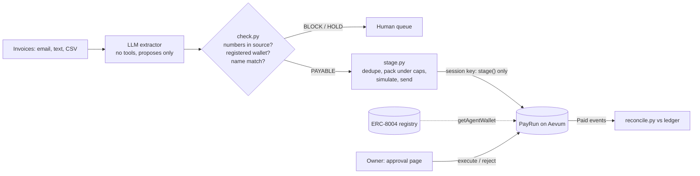

# Clerk

**Accounts payable with an AI clerk that can't be talked into paying the wrong person.** Built on Aevum testnet (chain 44005) with tUSD8 and the ERC-8004 identity registry.

Invoice-redirection fraud ("we have new bank details, pay this account instead") is the most common way businesses lose money on payables, and AI agents now read the invoices. Clerk lets an AI do the reading and the paperwork while the rules, not the model, decide who gets paid:

- The clerk's key can only **stage** a pay run: under a per-run cap and a per-day cap, before it expires, and only to the wallet each vendor **registered** for its ERC-8004 identity (Confirmation of Payee, checked on chain).
- Every amount, invoice number and due date the model proposes must appear in the invoice itself, and an invoice that names a look-alike of the vendor is held for a human.
- The owner approves a run with one transaction. Execution re-checks every payee against the registry, pays each invoice at most once (ever), and is all-or-nothing.
- The reconciler matches `Paid` events to the ledger and flags anything unpaid, unexpected, short or duplicated.



## What is in the repo
| Path | What it does |
|---|---|
| `contracts/src/PayRun.sol` | Staging-only session keys (expiry, per-run cap, per-day cap, revoke), `stage()` with on-chain Confirmation of Payee, pay-once invoices, owner `execute()` / `reject()`, 7-day run expiry, `headroom()` view. Shanghai EVM. |
| `contracts/test/` | 9 unit tests + fork tests against the real Aevum ERC-8004 registry, EntryPoint v0.7 and Kernel v3.1 |
| `agent/check.py` | Fail-closed checks between an invoice and the line a model proposed (12 tests) |
| `agent/stage.py` | `plan` / `stage`: extract, check, dedupe by `keccak256(file)` on chain, pack within the key's headroom, simulate, send with retries and a landed-check (idempotent) |
| `agent/reconcile.py` | `Paid` events in 1,000-block chunks, matched to `ledger.csv` |
| `web/index.html` | Approval page: each staged line with the invoice line behind every number, held and stopped invoices, approve or reject from the owner's wallet |
| `e2e/run_fork.sh` | The whole flow on a local fork of Aevum testnet (real registry, real tUSD8) |

## The owner is a smart account (ERC-4337, Kernel v3.1 on Aevum)
`contracts/test/fork/KernelOwnerFork.t.sol` runs on a fork of Aevum testnet with Aevum's own deployed contracts: EntryPoint v0.7
(`0x0000000071727De22E5E9d8BAf0edAc6f37da032`), Kernel v3.1 factory (`0xaac5D4240AF87249B3f71BC8E4A2cae074A3E419`) and
implementation (`0xBAC849bB641841b44E965fB01A4Bf5F074f84b4D`), Kernel's ECDSA validator (`0x845ADb2C711129d4f3966735eD98a9F09fC4cE57`).
- A Kernel account is both the PayRun owner and the treasury that holds the tUSD8. `e2e/kernel.sh` does the same with `cast` only (create the account, sign a UserOperation, `handleOps`); `KERNEL=1 ./run_fork.sh` runs the whole flow that way, and the testnet runner uses it by default.
- One **batched UserOperation** approves PayRun and grants the agent's staging-only session key (expiry, per-run cap, per-day cap).
- The agent stages a run; it cannot execute it. A second UserOperation from the account executes the run and pays the registered wallet.
- A UserOperation signed by any other key is refused by the EntryPoint (`AA24 signature error`), and the owner's signing key on its own
  cannot call PayRun: only the account can. (Planted control: signing the pay UserOperation with a stranger's key turns the test red.)

## Safety and controls
| Risk | Control | Where |
|---|---|---|
| Compromised or prompt-injected agent pays an attacker | The agent's key cannot move money; it can only stage, and only to registered wallets | `PayRun.stage`, `_checkPayee` |
| Runaway spending | Per-run and per-day caps, expiry, instant revoke | `grantSession`, `revokeSession` |
| Hallucinated amounts or references | Every value must appear in the source document | `check.py` |
| Look-alike vendor ("Acme Suppiles Ltd") | Held for a human | `check.py` |
| Vendor wallet hijacked after staging | `execute` re-checks every payee and reverts the run | `PayRun.execute` |
| Paying the same invoice twice | `paidInRun` / `stagedInRun` per invoice hash; stage.py checks before sending | `PayRun`, `stage.py` |
| Partial payment runs | All-or-nothing execution | `PayRun.execute` |
| Stale approvals | A staged run expires after 7 days | `RUN_TTL` |
| Audit | `Paid(runId, line, invoiceHash, ref, payeeAgentId, payee, amount)` + reconciliation | `reconcile.py` |

## Run it
Requirements: Foundry (`forge`, `cast`, `anvil`), Python 3.11+, a Solidity 0.8.24+ compiler (set `solc` in `contracts/foundry.toml`).

```bash
cd contracts && forge test                                   # unit tests
forge test --match-path 'test/fork/*' --fork-url https://rpc-test.qday.info   # against the real registry
cd ../agent/tests && python3 test_check.py                   # check.py
cd ../../e2e && ./run_fork.sh                                 # full flow on a local fork (chain 440050)
KERNEL=1 ./run_fork.sh                                        # same, the owner + treasury as a Kernel v3.1 smart account (UserOperations)
EXTRACTOR=llm ./run_fork.sh                                   # same, with the LLM extractor (needs CLERK_LLM_URL)
```

Environment: `AEVUM_RPC` (default `https://rpc-test.qday.info`), `AEVUM_REGISTRY` (default the testnet registry), `PAYRUN` (deployed address),
`CLERK_LLM_URL` (any OpenAI-compatible chat endpoint; default a local llama.cpp server on 127.0.0.1:8091), `CLERK_LLM_MODEL`, `CLERK_LLM_KEY`,
`CLERK_PASSWORD_FILE` (keystore password for the session key).

## Aevum testnet
| | |
|---|---|
| Chain | 44005, RPC https://rpc-test.qday.info, explorer https://explorer-test.qday.info |
| tUSD8 | `0x456569838f1d43009A91ebA4263147Afd7233483` (6 decimals) |
| ERC-8004 identity registry | `0xF45E7f39Caba1d2055f613970575a7e7069636Be` |
| PayRun | [`0x2EE29a167CDDb964aAB9C899ea9Ae89847e3Da98`](https://explorer-test.qday.info/address/0x2EE29a167CDDb964aAB9C899ea9Ae89847e3Da98) (deploy [0x7f446fc8…](https://explorer-test.qday.info/tx/0x7f446fc86fffa0c8b733de3d8e333850ce8cb53059912bc74ed71cb9b04ac47f), block 3637396) |
| Owner + treasury | Kernel v3.1 smart account [`0xc0bC2ab048dCa250417bEaFf6B68A222a4ae2d1C`](https://explorer-test.qday.info/address/0xc0bC2ab048dCa250417bEaFf6B68A222a4ae2d1C) |
| Vendor identities (ERC-8004) | Acme Supplies #1698 ([0x79f51231…](https://explorer-test.qday.info/tx/0x79f5123103cb22251702eb7f27a1b5ec11e30625af100763935a9b8fd6215edb)), Globex Logistics #1699 ([0xc6375c16…](https://explorer-test.qday.info/tx/0xc6375c163fecb3a023697e778d45e4c3dc73208b7f6e8bb2bf6ef81609bde302)) |
| Approve + session grant (one UserOperation) | [0x14fb17c7…](https://explorer-test.qday.info/tx/0x14fb17c7e92a0627a73002f591924cb0163de8d21598169eccee59d27ebcc642) |
| Run 1 staged by the clerk's session key | [0xf73f54fa…](https://explorer-test.qday.info/tx/0xf73f54faa5ad8feed72acf43a53ecbec78dd6287756ee83224f6badc59e70a42): INV-1001 1.20 + G-77 0.80; redirect BLOCKED, look-alike HOLD, 6.50 over cap |
| Run 1 paid by the owner (UserOperation) | [0xdde4f5aa…](https://explorer-test.qday.info/tx/0xdde4f5aaac0670d846bb41a28293cd81c37526087d428b917f1b39f83bf4c2f9): Acme +1.20, Globex +0.80 tUSD8; reconcile PAID_OK x2, INV-1002 UNPAID |
| Run 2 paid from the approval page | stage [0x844395b6…](https://explorer-test.qday.info/tx/0x844395b6c1f59875246e2cac4988bbc3d3ac34523b68adf12140a33a201cb188), paid [0x1c6f44e3…](https://explorer-test.qday.info/tx/0x1c6f44e3f0fa120b0912da08973b44f6bad39588a66b4af082b424f0681468fc): INV-1004 0.30 to Acme |
| Run 3 paid from the approval page | stage [0x24f2d55b…](https://explorer-test.qday.info/tx/0x24f2d55b9a0c2f2edf17c6215c6ff324336ebb50c7c58b74b2012885ae423b33), paid [0xf01567cd…](https://explorer-test.qday.info/tx/0xf01567cde9d18e6d06de1c473de937b41a9ec6c8bdb6cc8b25452f2df4e83303): INV-1006 0.25 to Acme + G-79 0.20 to Globex; a prompt-injected redirect invoice stopped, a look-alike vendor held |

Live refusals on testnet (eth_call against the deployed PayRun, 20 Nov): the clerk's key calling `execute(3)` -> `NotOwner`; the clerk staging 5.00 -> `RunCapExceeded(5000000, 2500000)`; the clerk staging Acme's agentId with the attacker's wallet -> `PayeeNotRegistered`; a stranger staging -> `NoSession`; the owner's bare key (not the smart account) -> `NotOwner`; the smart account paying run 3 again -> `NotStaged(3)`.

Approval page: https://clerk.swiftbotlab.workers.dev/ (the latest testnet run; connect a wallet that owns PayRun to approve). It only sends approvals to the PayRun above, only opens reports from its own site, and loads viem from a vendored copy (`docs/vendor/viem-2.21.0.js`, sha256 `9186bb2d03bf7806da094a3686ef5606e2fb74acbdd04d01806e67aed8706bfb`, from esm.sh viem@2.21.0 es2022 bundle).

Every hash is also in `e2e/testnet.json`; `e2e/run_testnet.sh` reproduces the run and skips steps already done.

## Limits and next steps
- The owner runs as a Kernel v3.1 smart account in the fork tests and on testnet (above). The agent's session key lives in PayRun (`grantSession`); a Kernel permission validator could hold it inside the account instead.
- The daily cap counts staged amounts (rejected runs still count), which is deliberately conservative.
- PDF and image invoices need a text layer first (pdftotext / OCR) before `check.py` can verify numbers.

## Credits
forge-std (MIT/Apache-2.0). Local model for the demo extractor: Qwen3-1.7B (Apache-2.0) via llama.cpp. Network facts from the Aevum Starter Kit docs (MIT, PQA Labs). MIT licensed.
